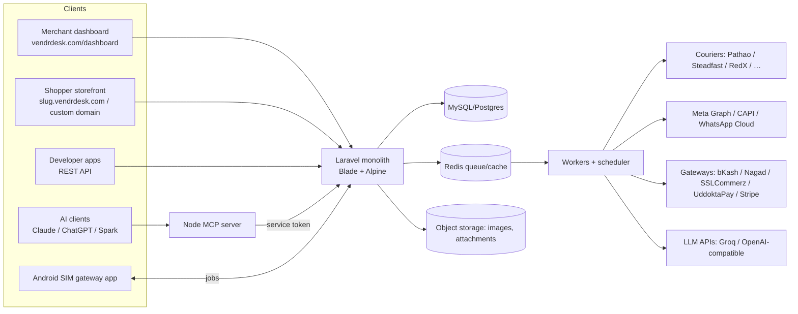
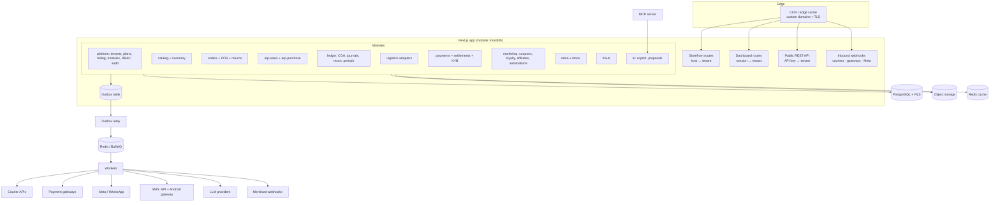
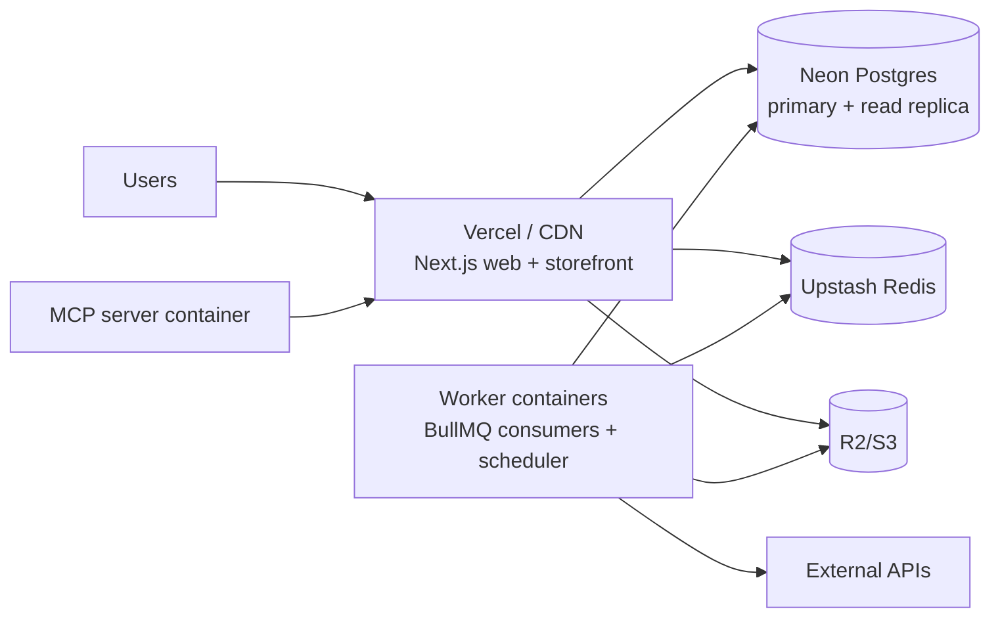

# Architecture

Part A describes what VendrDesk runs today, as far as can be seen from outside. Part B proposes a target architecture for building an equivalent platform.

---

## A. Observed architecture (reverse-engineered)

| Signal | Inference |
|---|---|
| Hidden `_token` field on every form, `POST /dashboard/x/{id}` with method spoofing, `/profile` and `/password` routes, `Laravel` named in the MCP config (`LARAVEL_BASE_URL`) | **Laravel (PHP) monolith** using Breeze-style auth and server-rendered Blade views, with sprinkles of JS (Alpine-style toggles and modals) |
| All dashboard routes on `vendrdesk.com/dashboard/*`; storefronts on `{slug}.vendrdesk.com`; custom domains | **Single multi-tenant app**. The tenant is resolved from the session for the dashboard and from the host for the storefront. Tenant IDs are UUIDs; most business tables use integer IDs. |
| `services/mcp-server/dist/server.js` (Node), port 8787, `VENDRDESK_SERVICE_TOKEN` | A separate **Node.js MCP server** sidecar that calls back into Laravel through a service token. 77 tools. |
| `/api/v1/payments`, `vpk_test_` keys, Idempotency-Key, signed webhooks, sandbox scenarios | A public REST API ("VendrPay") with a test/live split |
| Automatic courier dispatch, recurring journals, SMS queue, webhook retries, daily settlements | **Queue workers + scheduler** (Laravel Queue/Horizon + cron) |
| Android SIM device pairing | A device-gateway app that polls or holds a socket for outgoing SMS jobs |
| GTM, Facebook Pixel and CAPI on the marketing site | Server-side event forwarding to Meta |
| Voucher numbers like `CV-2026-00000127`, `SA-2026-000043`, `TRN-20261125-XTSG`, `ORD-01M77…` (ULID) | Per-tenant document sequences plus ULIDs for public order references |



---

## B. Target architecture (proposed rebuild)

### B.1 Principles
1. **Modular monolith first.** One deployable with strict module boundaries (catalog, orders, erp-sales, erp-purchase, inventory, ledger, logistics, payments, marketing, meta, ai, platform). Split a module into its own service only when its scale requires it. Webhook ingestion and workers are the likely first candidates.
2. **The ledger is the source of truth for money; stock movements are the source of truth for stock.** Business documents produce postings inside the **same DB transaction**.
3. **Tenant isolation in depth.** `tenant_id` on every row, app-level scoping, and Postgres row-level security as a backstop.
4. **Integrations go behind adapters.** Each courier, gateway or channel implements one interface, so a provider can be added without touching core code.
5. **Async by default for side effects.** Use an outbox, queue, idempotent consumers and retries.

### B.2 Stack (aligned with the existing `mmsolution` stack)

| Layer | Choice |
|---|---|
| Web/dashboard | Next.js 15 (App Router, RSC) + React 19 + TypeScript + Tailwind; TanStack Table for grids; server actions for mutations |
| Storefront | The same Next.js app on a separate route group, resolved by host. ISR/edge cache keyed on tenant + path; on-demand revalidation when content is published |
| API | REST `/api/v1` (public, API-key auth) + internal server actions; OpenAPI spec generated from Zod |
| Domain/ORM | Prisma 6 (or Drizzle) on **PostgreSQL 16**; Zod validation; domain services per module |
| Jobs | BullMQ on Redis (or `pg-boss` while small): dispatch, sync, webhooks, recurring journals, depreciation, reports export, SMS |
| Cache | Redis (sessions, rate limits, hot catalogue, carts) |
| Search | Postgres `pg_trgm` + full-text to begin with; Meilisearch/Typesense when catalogues pass 50k SKUs |
| Files | S3-compatible storage (R2/S3) + image CDN with on-the-fly resizing |
| Realtime | SSE/WebSocket channel for new-order alerts, inbox messages and POS sync |
| AI | MCP server (TypeScript, `@modelcontextprotocol/sdk`) inside the monorepo, calling the domain services directly with a scoped tenant token; LLM calls through a provider-agnostic client |
| Infra | Vercel (web) + Neon Postgres + Upstash Redis to start; containerised workers (Fly/Railway/K8s) for long-running jobs |
| Observability | OpenTelemetry → Grafana/Tempo or Datadog; Sentry; per-tenant job dashboards |

### B.3 Logical view



### B.4 Module boundaries and dependencies

```
platform  ←  everyone (tenant context, auth, RBAC, audit, feature flags)
catalog   ←  orders, erp-*, inventory, marketing, meta (feed)
inventory ←  orders, pos, erp-sales, erp-purchase   (writes stock_movements only through InventoryService)
ledger    ←  orders, pos, erp-*, payments, logistics (COD), assets/loans   (writes only through PostingService)
logistics →  orders (status events)
payments  →  orders/erp (payment events), ledger
ai        →  calls other modules' public services ONLY via proposal executor
```
Rule: modules talk through **service interfaces + domain events**, never through each other's tables.

### B.5 Key runtime flows

**Order placed (storefront):**
```mermaid
sequenceDiagram
  participant C as Shopper
  participant SF as Storefront
  participant O as Orders
  participant I as Inventory
  participant F as Fraud
  participant L as Ledger
  participant Q as Outbox/Queue
  C->>SF: Checkout (COD)
  SF->>O: createOrder()
  activate O
  O->>I: reserve(items)  %% same tx
  O->>F: score(phone, ip)
  O->>Q: OrderPlaced event (outbox row)
  deactivate O
  Q-->>Merchant: realtime alert + WhatsApp/SMS
  Q-->>Meta CAPI: Purchase event
  Note over O: Merchant confirms → if auto-dispatch: LogisticsAdapter.createConsignment()
  Q-->>O: Courier webhook "delivered"
  O->>I: commit reservation → stock_movement(sale)
  O->>L: post(Dr AR-Courier / Cr Sales, Cr VAT; Dr COGS / Cr Inventory)
  Q-->>L: COD payout file → post(Dr Bank, Dr Courier fee / Cr AR-Courier)
```

**AI write via MCP:**
```
Claude → MCP tool create_coupon(args) → AiService.propose() → agent_actions(status=pending)
Owner clicks Approve → ProposalExecutor runs CouponService.create() as the approving user → audit_log + agent_actions(status=executed, result)
```

**Payment API:**
```
POST /api/v1/payments (Idempotency-Key) → payment_intents row → checkout_url
Gateway callback → verify signature → intent.succeeded (idempotent) → ledger post → outbound webhook (HMAC, retry 1m/5m/30m/2h/12h) → delivery log
```

### B.6 Multi-tenancy
- **Resolution:** storefront uses `Host` → `domains` table (cached) → tenant; dashboard uses session → `memberships` → active tenant; API uses key prefix lookup → hashed secret compare → tenant.
- **Enforcement:** Prisma client extension injects `tenant_id` into every query. Each request runs `SET LOCAL app.tenant_id = …`, and RLS policies check `tenant_id = current_setting('app.tenant_id')::uuid`.
- **Noisy neighbours:** per-tenant rate limits and job concurrency keys. Large tenants can be moved to a dedicated database shard later, because `tenant_id` leads every primary index.

### B.7 Security
- Passwords hashed with argon2id. Opaque DB sessions (the pattern `mmsolution` already uses). 2FA for owners.
- RBAC permission strings such as `erp.invoice.verify` are checked by middleware and inside services.
- Third-party credentials (courier, Meta, gateway, LLM) live in `integration_credentials`, AES-GCM-encrypted with a KMS data key and never sent to the browser in full (masked).
- API keys store only a SHA-256 hash; the UI shows the prefix.
- Webhooks: inbound signatures are verified; outbound requests are HMAC-SHA256 signed with a timestamp to stop replays.
- Destructive bulk actions need typed confirmation plus the `*.purge` permission, and are soft-deleted with a 30-day restore window.
- Audit log is append-only, with before/after JSON diffs and actor (user / API key / AI agent).

### B.8 Deployment topology


Environments: `dev` (Neon branch per PR) → `staging` → `prod`. Migrations run with `prisma migrate deploy` in CI before promotion.

### B.9 Scaling path
1. Read replica for reports. Heavy reports (GL, aging) run as async exports.
2. Partition `stock_movements`, `journal_lines` and `audit_logs` by month.
3. Move webhook ingestion and the outbox relay to their own service.
4. Shard by tenant if a single primary exceeds about 5 TB or write saturation.
