# Database Design (PostgreSQL 16)

These tables are derived from the forms, tables and document numbers seen in VendrDesk, and normalised for a clean rebuild. Conventions:

- `id BIGINT GENERATED ALWAYS AS IDENTITY` for internal keys. `public_id` (ULID text) wherever an ID appears in URLs or the API.
- **Every tenant-owned table** has `tenant_id UUID NOT NULL`, its unique keys are `(tenant_id, …)`, and an RLS policy restricts rows to the current tenant.
- Money is `NUMERIC(18,2)` and quantities are `NUMERIC(18,3)`. Timestamps are `TIMESTAMPTZ`. `created_at`, `updated_at`, `deleted_at` (soft delete) and `created_by` appear on mutable tables (omitted below for brevity).
- Status columns are Postgres enums or `TEXT` with a CHECK constraint.

---

## 1. Entity-relationship overview

```mermaid
erDiagram
  TENANTS ||--o{ MEMBERSHIPS : has
  USERS ||--o{ MEMBERSHIPS : joins
  ROLES ||--o{ MEMBERSHIPS : grants
  ROLES ||--o{ ROLE_PERMISSIONS : contains
  TENANTS ||--o{ SUBSCRIPTIONS : billed
  PLANS ||--o{ SUBSCRIPTIONS : on
  TENANTS ||--o{ TENANT_MODULES : enables
  TENANTS ||--o{ DOMAINS : serves

  CATEGORIES ||--o{ PRODUCTS : groups
  BRANDS ||--o{ PRODUCTS : brands
  PRODUCTS ||--o{ PRODUCT_VARIANTS : has
  PRODUCT_VARIANTS ||--o{ STOCK_LEVELS : stocked_at
  WAREHOUSES ||--o{ STOCK_LEVELS : holds
  PRODUCT_VARIANTS ||--o{ STOCK_MOVEMENTS : moves
  PRICE_LISTS ||--o{ PRICE_LIST_ITEMS : prices

  CUSTOMERS ||--o{ ORDERS : places
  ORDERS ||--o{ ORDER_ITEMS : contains
  ORDERS ||--o{ ORDER_EVENTS : timeline
  ORDERS ||--o{ SHIPMENTS : shipped_by
  ORDERS ||--o{ PAYMENTS : paid_by
  ORDERS ||--o{ RETURNS : returned
  POS_SHIFTS ||--o{ ORDERS : rings

  CUSTOMERS ||--o{ SALES_INVOICES : billed
  SALES_INVOICES ||--o{ SALES_INVOICE_ITEMS : lines
  QUOTATIONS ||--o{ QUOTATION_ITEMS : lines
  SALES_INVOICES ||--o{ DELIVERY_CHALLANS : delivered
  CUSTOMER_RECEIPTS ||--o{ RECEIPT_ALLOCATIONS : allocates
  RECEIPT_ALLOCATIONS }o--|| SALES_INVOICES : settles

  SUPPLIERS ||--o{ PURCHASE_ORDERS : receives
  PURCHASE_ORDERS ||--o{ GOODS_RECEIPTS : fulfilled_by
  SUPPLIERS ||--o{ PURCHASE_BILLS : bills
  PURCHASE_BILLS ||--o{ PURCHASE_BILL_ITEMS : lines
  SUPPLIER_PAYMENTS ||--o{ PAYMENT_ALLOCATIONS : allocates
  PAYMENT_ALLOCATIONS }o--|| PURCHASE_BILLS : settles

  ACCOUNTS ||--o{ JOURNAL_LINES : posted_to
  JOURNALS ||--o{ JOURNAL_LINES : contains
  ACCOUNTS ||--o| BANK_ACCOUNTS : is
  BANK_ACCOUNTS ||--o{ BANK_STATEMENT_LINES : statement
```



Every business document (invoice, bill, receipt, payment, POS sale, adjustment, return) has a nullable `journal_id` pointing to the journal it posted. Every stock-affecting line creates `stock_movements` with `(source_type, source_id)`.

---

## 2. Platform & tenancy

```sql
CREATE TABLE tenants (
  id UUID PRIMARY KEY DEFAULT gen_random_uuid(),
  slug CITEXT UNIQUE NOT NULL,                -- crownliving → crownliving.platform.com
  name TEXT NOT NULL,
  owner_user_id BIGINT NOT NULL,
  template TEXT NOT NULL DEFAULT 'minimal',   -- minimal|aurora|bloom|haven|modern
  currency CHAR(3) NOT NULL DEFAULT 'BDT',
  timezone TEXT NOT NULL DEFAULT 'Asia/Dhaka',
  status TEXT NOT NULL DEFAULT 'trial',       -- trial|active|read_only|suspended|closed
  trial_ends_at TIMESTAMPTZ,
  kyb_status TEXT NOT NULL DEFAULT 'not_submitted', -- not_submitted|pending|approved|rejected
  settings JSONB NOT NULL DEFAULT '{}',       -- general, theme content, tracking, footer, social, seo, notifications…
  created_at TIMESTAMPTZ NOT NULL DEFAULT now()
);

CREATE TABLE domains (
  id BIGINT GENERATED ALWAYS AS IDENTITY PRIMARY KEY,
  tenant_id UUID NOT NULL REFERENCES tenants,
  hostname CITEXT UNIQUE NOT NULL,
  is_primary BOOLEAN NOT NULL DEFAULT false,
  verification_token TEXT, verified_at TIMESTAMPTZ, tls_status TEXT
);

CREATE TABLE users (
  id BIGINT GENERATED ALWAYS AS IDENTITY PRIMARY KEY,
  name TEXT NOT NULL, email CITEXT UNIQUE NOT NULL, phone TEXT,
  password_hash TEXT NOT NULL, totp_secret_enc BYTEA,
  email_verified_at TIMESTAMPTZ, last_login_at TIMESTAMPTZ
);
CREATE TABLE sessions (id TEXT PRIMARY KEY, user_id BIGINT REFERENCES users, tenant_id UUID,
  ip INET, user_agent TEXT, expires_at TIMESTAMPTZ NOT NULL);

CREATE TABLE roles (
  id BIGINT GENERATED ALWAYS AS IDENTITY PRIMARY KEY,
  tenant_id UUID REFERENCES tenants,          -- NULL = built-in preset
  name TEXT NOT NULL, is_system BOOLEAN NOT NULL DEFAULT false,
  UNIQUE (tenant_id, name)
);
CREATE TABLE role_permissions (
  role_id BIGINT REFERENCES roles ON DELETE CASCADE,
  resource TEXT NOT NULL,                     -- 'erp.invoice', 'orders', 'ledger.voucher'…
  actions TEXT[] NOT NULL,                    -- {view,create,update,delete,verify}
  PRIMARY KEY (role_id, resource)
);
CREATE TABLE memberships (
  tenant_id UUID REFERENCES tenants, user_id BIGINT REFERENCES users,
  role_id BIGINT REFERENCES roles, status TEXT NOT NULL DEFAULT 'active',
  PRIMARY KEY (tenant_id, user_id)
);

CREATE TABLE plans (
  id BIGINT GENERATED ALWAYS AS IDENTITY PRIMARY KEY,
  code TEXT UNIQUE NOT NULL,                  -- launch|build|dominate|gym_starter…
  name TEXT, price_monthly NUMERIC(18,2), price_yearly NUMERIC(18,2),
  limits JSONB NOT NULL,                      -- {"products":200,"seats":2,"notifications":50}
  features TEXT[] NOT NULL
);
CREATE TABLE subscriptions (
  id BIGINT GENERATED ALWAYS AS IDENTITY PRIMARY KEY,
  tenant_id UUID NOT NULL REFERENCES tenants, plan_id BIGINT REFERENCES plans,
  cycle TEXT NOT NULL CHECK (cycle IN ('monthly','yearly')),
  status TEXT NOT NULL, current_period_start DATE, current_period_end DATE, cancel_at DATE
);
CREATE TABLE billing_invoices (
  id BIGINT GENERATED ALWAYS AS IDENTITY PRIMARY KEY, tenant_id UUID NOT NULL,
  subscription_id BIGINT REFERENCES subscriptions, number TEXT UNIQUE,
  amount NUMERIC(18,2), status TEXT, gateway TEXT, gateway_ref TEXT, paid_at TIMESTAMPTZ
);
CREATE TABLE tenant_modules (
  tenant_id UUID REFERENCES tenants, module TEXT,   -- storefront|erp|pos|meta|marketing|inbox|sms|fraud|finance|portfolio|gym
  enabled BOOLEAN NOT NULL, toggled_at TIMESTAMPTZ, PRIMARY KEY (tenant_id, module)
);
CREATE TABLE wallets (tenant_id UUID PRIMARY KEY REFERENCES tenants, balance NUMERIC(18,2) NOT NULL DEFAULT 0);
CREATE TABLE wallet_transactions (id BIGINT GENERATED ALWAYS AS IDENTITY PRIMARY KEY, tenant_id UUID NOT NULL,
  type TEXT, amount NUMERIC(18,2), balance_after NUMERIC(18,2), reference TEXT, status TEXT, created_at TIMESTAMPTZ DEFAULT now());

CREATE TABLE document_sequences (                -- CV-2026-00000127, SA-2026-000043, INV-20261118-001
  tenant_id UUID, doc_type TEXT, prefix TEXT NOT NULL, pattern TEXT NOT NULL,
  period_key TEXT NOT NULL DEFAULT '', next_value BIGINT NOT NULL DEFAULT 1,
  PRIMARY KEY (tenant_id, doc_type, period_key)
);  -- incremented with SELECT … FOR UPDATE inside the posting transaction

CREATE TABLE audit_logs (                       -- partitioned monthly
  id BIGINT GENERATED ALWAYS AS IDENTITY, tenant_id UUID NOT NULL,
  actor_type TEXT NOT NULL, actor_id TEXT,        -- user|api_key|ai_agent|system
  action TEXT NOT NULL, entity_type TEXT, entity_id TEXT,
  before JSONB, after JSONB, ip INET, created_at TIMESTAMPTZ NOT NULL DEFAULT now(),
  reverted_by BIGINT, PRIMARY KEY (id, created_at)
) PARTITION BY RANGE (created_at);

CREATE TABLE integration_credentials (          -- courier, gateway, meta, llm, sms
  id BIGINT GENERATED ALWAYS AS IDENTITY PRIMARY KEY, tenant_id UUID NOT NULL,
  provider TEXT NOT NULL, mode TEXT NOT NULL DEFAULT 'live',
  config JSONB NOT NULL DEFAULT '{}',           -- non-secret (store_id, city_id, pixel_id)
  secret_enc BYTEA,                             -- AES-GCM envelope
  enabled BOOLEAN DEFAULT true, last_tested_at TIMESTAMPTZ,
  UNIQUE (tenant_id, provider, mode)
);
```

## 3. Catalog & inventory

```sql
CREATE TABLE categories (id BIGINT GENERATED ALWAYS AS IDENTITY PRIMARY KEY, tenant_id UUID NOT NULL,
  parent_id BIGINT REFERENCES categories, name TEXT NOT NULL, slug TEXT NOT NULL, description TEXT,
  menu_label TEXT, mega_menu_description TEXT, image_url TEXT, sort_order INT DEFAULT 0,
  is_featured_in_menu BOOLEAN DEFAULT false, status TEXT DEFAULT 'active', UNIQUE (tenant_id, slug));
CREATE TABLE brands (id BIGINT GENERATED ALWAYS AS IDENTITY PRIMARY KEY, tenant_id UUID NOT NULL, name TEXT, description TEXT, UNIQUE(tenant_id,name));
CREATE TABLE manufacturers (id BIGINT GENERATED ALWAYS AS IDENTITY PRIMARY KEY, tenant_id UUID NOT NULL, name TEXT,
  contact_name TEXT, phone TEXT, address TEXT);

CREATE TABLE products (
  id BIGINT GENERATED ALWAYS AS IDENTITY PRIMARY KEY, tenant_id UUID NOT NULL,
  name TEXT NOT NULL, slug TEXT NOT NULL,
  category_id BIGINT REFERENCES categories, brand_id BIGINT REFERENCES brands, manufacturer_id BIGINT REFERENCES manufacturers,
  channel TEXT NOT NULL DEFAULT 'omni' CHECK (channel IN ('omni','online','offline')),
  short_description TEXT, description TEXT, size_chart TEXT,
  item_type TEXT DEFAULT 'standard',            -- standard|serialized|batched|service|bundle
  unit TEXT DEFAULT 'pcs', vat_rate NUMERIC(5,2) DEFAULT 0,
  seo_title TEXT, seo_description TEXT, is_gift BOOLEAN DEFAULT false,
  status TEXT NOT NULL DEFAULT 'draft',         -- draft|active|archived
  UNIQUE (tenant_id, slug)
);
CREATE TABLE product_images (id BIGINT GENERATED ALWAYS AS IDENTITY PRIMARY KEY, tenant_id UUID, product_id BIGINT REFERENCES products ON DELETE CASCADE, url TEXT, sort_order INT);
CREATE TABLE product_variants (
  id BIGINT GENERATED ALWAYS AS IDENTITY PRIMARY KEY, tenant_id UUID NOT NULL,
  product_id BIGINT NOT NULL REFERENCES products ON DELETE CASCADE,
  sku TEXT, barcode TEXT, options JSONB NOT NULL DEFAULT '{}',   -- {"color":"White","size":"L"}
  cost_price NUMERIC(18,2) NOT NULL DEFAULT 0,                  -- COGS basis (moving average)
  online_price NUMERIC(18,2) NOT NULL, online_compare_at NUMERIC(18,2),
  offline_price NUMERIC(18,2),                                  -- POS / ERP default
  low_stock_threshold NUMERIC(18,3) DEFAULT 5, weight_kg NUMERIC(8,3),
  is_default BOOLEAN DEFAULT true,
  UNIQUE (tenant_id, sku), UNIQUE (tenant_id, barcode)
);
CREATE TABLE price_lists (id BIGINT GENERATED ALWAYS AS IDENTITY PRIMARY KEY, tenant_id UUID, name TEXT, is_default BOOLEAN);
CREATE TABLE price_list_items (price_list_id BIGINT REFERENCES price_lists, variant_id BIGINT REFERENCES product_variants,
  price NUMERIC(18,2), PRIMARY KEY (price_list_id, variant_id));

CREATE TABLE warehouses (id BIGINT GENERATED ALWAYS AS IDENTITY PRIMARY KEY, tenant_id UUID NOT NULL,
  name TEXT NOT NULL, type TEXT DEFAULT 'warehouse',  -- warehouse|showroom|default
  address TEXT, is_default BOOLEAN DEFAULT false);
CREATE TABLE warehouse_users (warehouse_id BIGINT REFERENCES warehouses, user_id BIGINT REFERENCES users, PRIMARY KEY (warehouse_id,user_id));

CREATE TABLE stock_levels (                       -- current on-hand, updated in same tx as movement
  tenant_id UUID NOT NULL, variant_id BIGINT REFERENCES product_variants, warehouse_id BIGINT REFERENCES warehouses,
  on_hand NUMERIC(18,3) NOT NULL DEFAULT 0, reserved NUMERIC(18,3) NOT NULL DEFAULT 0,
  avg_cost NUMERIC(18,4) NOT NULL DEFAULT 0,
  PRIMARY KEY (tenant_id, variant_id, warehouse_id)
);
CREATE TABLE stock_movements (                    -- immutable; partitioned monthly
  id BIGINT GENERATED ALWAYS AS IDENTITY, tenant_id UUID NOT NULL,
  variant_id BIGINT NOT NULL, warehouse_id BIGINT NOT NULL,
  type TEXT NOT NULL,     -- sale|pos_sale|purchase|sales_return|purchase_return|adjustment_in|adjustment_out|transfer_in|transfer_out|opening
  qty_change NUMERIC(18,3) NOT NULL, qty_before NUMERIC(18,3) NOT NULL, qty_after NUMERIC(18,3) NOT NULL,
  unit_cost NUMERIC(18,4), source_type TEXT NOT NULL, source_id BIGINT NOT NULL, reference_no TEXT,
  batch_no TEXT, serial_no TEXT, notes TEXT, created_by BIGINT, created_at TIMESTAMPTZ NOT NULL DEFAULT now(),
  PRIMARY KEY (id, created_at)
) PARTITION BY RANGE (created_at);
CREATE INDEX ON stock_movements (tenant_id, variant_id, created_at);

CREATE TABLE stock_adjustments (id BIGINT GENERATED ALWAYS AS IDENTITY PRIMARY KEY, tenant_id UUID NOT NULL,
  number TEXT NOT NULL, date DATE, warehouse_id BIGINT, type TEXT, reason TEXT, notes TEXT,
  status TEXT DEFAULT 'posted', journal_id BIGINT, UNIQUE(tenant_id, number));
CREATE TABLE stock_adjustment_items (id BIGINT GENERATED ALWAYS AS IDENTITY PRIMARY KEY, adjustment_id BIGINT REFERENCES stock_adjustments,
  variant_id BIGINT, prev_qty NUMERIC(18,3), qty_adjusted NUMERIC(18,3), new_qty NUMERIC(18,3), unit_cost NUMERIC(18,4));
CREATE TABLE stock_transfers (id BIGINT GENERATED ALWAYS AS IDENTITY PRIMARY KEY, tenant_id UUID NOT NULL,
  number TEXT, date DATE, from_warehouse_id BIGINT, to_warehouse_id BIGINT, carrier TEXT, notes TEXT,
  status TEXT DEFAULT 'issued');  -- issued|in_transit|received|cancelled
CREATE TABLE stock_transfer_items (transfer_id BIGINT REFERENCES stock_transfers, variant_id BIGINT, qty NUMERIC(18,3), unit_cost NUMERIC(18,4));
```

## 4. Customers, storefront, orders, POS

```sql
CREATE TABLE customer_types (id BIGINT GENERATED ALWAYS AS IDENTITY PRIMARY KEY, tenant_id UUID NOT NULL,
  name TEXT, code TEXT, default_discount_pct NUMERIC(5,2) DEFAULT 0, default_credit_days INT DEFAULT 0,
  description TEXT, is_active BOOLEAN DEFAULT true);
CREATE TABLE customers (
  id BIGINT GENERATED ALWAYS AS IDENTITY PRIMARY KEY, tenant_id UUID NOT NULL,
  membership_id TEXT,                               -- CMID-2026-XXXXXX
  customer_type_id BIGINT REFERENCES customer_types,
  name TEXT NOT NULL, phone TEXT, email CITEXT, password_hash TEXT,   -- storefront login
  address TEXT, city TEXT, district TEXT,
  credit_limit NUMERIC(18,2) DEFAULT 0,
  opening_balance NUMERIC(18,2) DEFAULT 0, opening_balance_type CHAR(2) DEFAULT 'DR',
  loyalty_points NUMERIC(18,2) DEFAULT 0, status TEXT DEFAULT 'active',
  UNIQUE (tenant_id, phone), UNIQUE (tenant_id, membership_id)
);
CREATE TABLE customer_addresses (id BIGINT GENERATED ALWAYS AS IDENTITY PRIMARY KEY, customer_id BIGINT REFERENCES customers,
  label TEXT, address TEXT, district TEXT, zone TEXT, is_default BOOLEAN);

CREATE TABLE shipping_zones (id BIGINT GENERATED ALWAYS AS IDENTITY PRIMARY KEY, tenant_id UUID NOT NULL,
  name TEXT, districts TEXT[], base_charge NUMERIC(18,2), weight_tiers JSONB, -- [{"upto_kg":1,"charge":60}]
  method TEXT DEFAULT 'standard', eta TEXT, enabled BOOLEAN DEFAULT true);

CREATE TABLE carts (id BIGINT GENERATED ALWAYS AS IDENTITY PRIMARY KEY, tenant_id UUID NOT NULL, token TEXT UNIQUE,
  customer_id BIGINT, phone TEXT, items JSONB, subtotal NUMERIC(18,2), status TEXT DEFAULT 'open', -- open|converted|abandoned|recovered
  last_activity_at TIMESTAMPTZ, recovery_sent_at TIMESTAMPTZ);

CREATE TABLE orders (
  id BIGINT GENERATED ALWAYS AS IDENTITY PRIMARY KEY, tenant_id UUID NOT NULL,
  public_id TEXT UNIQUE NOT NULL,                     -- ORD-01M77P… (ULID)
  channel TEXT NOT NULL,                              -- storefront|pos|erp|messenger|whatsapp|api
  customer_id BIGINT REFERENCES customers, pos_shift_id BIGINT,
  warehouse_id BIGINT REFERENCES warehouses,
  status TEXT NOT NULL DEFAULT 'pending',             -- pending|confirmed|preparing|ready|packed|shipped|out_for_delivery|delivered|cancelled|returned|failed
  payment_status TEXT NOT NULL DEFAULT 'unpaid',      -- unpaid|partial|paid|refunded
  payment_method TEXT,                                -- cod|bkash|nagad|card|split|store_credit
  shipping_name TEXT, shipping_phone TEXT, shipping_address TEXT, shipping_district TEXT, shipping_zone_id BIGINT,
  subtotal NUMERIC(18,2), discount NUMERIC(18,2) DEFAULT 0, shipping_fee NUMERIC(18,2) DEFAULT 0,
  vat NUMERIC(18,2) DEFAULT 0, total NUMERIC(18,2) NOT NULL, paid_amount NUMERIC(18,2) DEFAULT 0,
  coupon_id BIGINT, affiliate_id BIGINT, risk_score INT, ip INET,
  utm JSONB, notes TEXT, journal_id BIGINT, placed_at TIMESTAMPTZ DEFAULT now()
);
CREATE INDEX ON orders (tenant_id, status, placed_at DESC);
CREATE TABLE order_items (id BIGINT GENERATED ALWAYS AS IDENTITY PRIMARY KEY, order_id BIGINT REFERENCES orders ON DELETE CASCADE,
  variant_id BIGINT, name TEXT, variant_label TEXT, qty NUMERIC(18,3), unit_price NUMERIC(18,2),
  discount NUMERIC(18,2) DEFAULT 0, vat NUMERIC(18,2) DEFAULT 0, line_total NUMERIC(18,2), unit_cost NUMERIC(18,4));
CREATE TABLE order_events (id BIGINT GENERATED ALWAYS AS IDENTITY PRIMARY KEY, order_id BIGINT REFERENCES orders,
  from_status TEXT, to_status TEXT, note TEXT, source TEXT, actor_id BIGINT, created_at TIMESTAMPTZ DEFAULT now());

CREATE TABLE pos_registers (id BIGINT GENERATED ALWAYS AS IDENTITY PRIMARY KEY, tenant_id UUID, name TEXT, warehouse_id BIGINT);
CREATE TABLE pos_shifts (id BIGINT GENERATED ALWAYS AS IDENTITY PRIMARY KEY, tenant_id UUID NOT NULL, register_id BIGINT,
  opened_by BIGINT, opened_at TIMESTAMPTZ, opening_float NUMERIC(18,2),
  closed_by BIGINT, closed_at TIMESTAMPTZ, counted_cash NUMERIC(18,2), expected_cash NUMERIC(18,2), notes TEXT,
  status TEXT DEFAULT 'open');
CREATE TABLE pos_cash_movements (id BIGINT GENERATED ALWAYS AS IDENTITY PRIMARY KEY, shift_id BIGINT REFERENCES pos_shifts,
  type TEXT, amount NUMERIC(18,2), reason TEXT, created_at TIMESTAMPTZ DEFAULT now());  -- cash_drop|pay_in|pay_out

CREATE TABLE returns (id BIGINT GENERATED ALWAYS AS IDENTITY PRIMARY KEY, tenant_id UUID NOT NULL,
  order_id BIGINT REFERENCES orders, reason TEXT, refund_amount NUMERIC(18,2), type TEXT DEFAULT 'return', -- return|exchange
  status TEXT DEFAULT 'requested', rejection_reason TEXT, restock BOOLEAN DEFAULT true, journal_id BIGINT);

CREATE TABLE reviews (id BIGINT GENERATED ALWAYS AS IDENTITY PRIMARY KEY, tenant_id UUID, product_id BIGINT, customer_id BIGINT,
  order_id BIGINT, rating SMALLINT CHECK (rating BETWEEN 1 AND 5), body TEXT, status TEXT DEFAULT 'pending');
```

## 5. Logistics

```sql
CREATE TABLE shipments (
  id BIGINT GENERATED ALWAYS AS IDENTITY PRIMARY KEY, tenant_id UUID NOT NULL,
  order_id BIGINT REFERENCES orders, internal_tracking TEXT,
  courier TEXT NOT NULL,                     -- pathao|steadfast|redx|ecourier|paperfly|sundarban|manual
  consignment_id TEXT, tracking_code TEXT, cod_amount NUMERIC(18,2), delivery_fee NUMERIC(18,2),
  status TEXT NOT NULL DEFAULT 'pending',    -- pending|picked_up|in_transit|delivered|returned|cancelled
  external_status TEXT, raw_response JSONB, dispatched_at TIMESTAMPTZ, delivered_at TIMESTAMPTZ
);
CREATE TABLE shipment_events (id BIGINT GENERATED ALWAYS AS IDENTITY PRIMARY KEY, shipment_id BIGINT REFERENCES shipments,
  status TEXT, external_status TEXT, payload JSONB, occurred_at TIMESTAMPTZ);
CREATE TABLE courier_payouts (id BIGINT GENERATED ALWAYS AS IDENTITY PRIMARY KEY, tenant_id UUID, courier TEXT,
  payout_ref TEXT, period_from DATE, period_to DATE, gross_cod NUMERIC(18,2), fees NUMERIC(18,2),
  net_amount NUMERIC(18,2), journal_id BIGINT, reconciled_at TIMESTAMPTZ);
CREATE TABLE courier_payout_lines (payout_id BIGINT REFERENCES courier_payouts, shipment_id BIGINT, cod NUMERIC(18,2), fee NUMERIC(18,2));
```

## 6. ERP sales

```sql
CREATE TABLE quotations (id BIGINT GENERATED ALWAYS AS IDENTITY PRIMARY KEY, tenant_id UUID NOT NULL, number TEXT,
  customer_id BIGINT, customer_name TEXT, date DATE, valid_until DATE, sales_person_id BIGINT, price_list_id BIGINT,
  subtotal NUMERIC(18,2), discount NUMERIC(18,2), tax_amount NUMERIC(18,2), additional_charge NUMERIC(18,2),
  adjustment NUMERIC(18,2), total NUMERIC(18,2), terms TEXT, status TEXT DEFAULT 'draft', -- draft|sent|accepted|rejected|converted
  converted_invoice_id BIGINT, attachment_url TEXT, UNIQUE (tenant_id, number));
CREATE TABLE quotation_items (id BIGINT GENERATED ALWAYS AS IDENTITY PRIMARY KEY, quotation_id BIGINT REFERENCES quotations,
  variant_id BIGINT, description TEXT, unit TEXT, qty NUMERIC(18,3), price NUMERIC(18,2), discount NUMERIC(18,2), vat NUMERIC(18,2), total NUMERIC(18,2));

CREATE TABLE sales_invoices (
  id BIGINT GENERATED ALWAYS AS IDENTITY PRIMARY KEY, tenant_id UUID NOT NULL,
  number TEXT NOT NULL, order_id BIGINT REFERENCES orders,  -- online/POS orders also produce an invoice
  customer_id BIGINT REFERENCES customers, invoice_date DATE NOT NULL, due_date DATE,
  sales_person_id BIGINT, price_list_id BIGINT, warehouse_id BIGINT,
  subtotal NUMERIC(18,2), discount NUMERIC(18,2) DEFAULT 0, vat NUMERIC(18,2) DEFAULT 0,
  additional_charge NUMERIC(18,2) DEFAULT 0, adjustment NUMERIC(18,2) DEFAULT 0,
  total NUMERIC(18,2) NOT NULL, paid NUMERIC(18,2) NOT NULL DEFAULT 0,
  due NUMERIC(18,2) GENERATED ALWAYS AS (total - paid) STORED,
  payment_status TEXT NOT NULL DEFAULT 'unpaid', status TEXT NOT NULL DEFAULT 'posted', -- draft|posted|void|returned
  notes TEXT, attachment_url TEXT, is_imported BOOLEAN DEFAULT false, journal_id BIGINT,
  UNIQUE (tenant_id, number)
);
CREATE INDEX ON sales_invoices (tenant_id, customer_id, invoice_date) WHERE due > 0;
CREATE TABLE sales_invoice_items (id BIGINT GENERATED ALWAYS AS IDENTITY PRIMARY KEY, invoice_id BIGINT REFERENCES sales_invoices ON DELETE CASCADE,
  variant_id BIGINT, description TEXT, unit TEXT, qty NUMERIC(18,3), price NUMERIC(18,2), discount NUMERIC(18,2),
  vat NUMERIC(18,2), amount NUMERIC(18,2), serial_batch TEXT, unit_cost NUMERIC(18,4));

CREATE TABLE delivery_challans (id BIGINT GENERATED ALWAYS AS IDENTITY PRIMARY KEY, tenant_id UUID NOT NULL, number TEXT,
  invoice_id BIGINT, order_id BIGINT, customer_id BIGINT, delivery_date DATE, delivery_type TEXT,
  delivery_charge NUMERIC(18,2), delivery_channel TEXT, channel_charge NUMERIC(18,2), consignment_id TEXT,
  contact_phone TEXT, address TEXT, notes TEXT, status TEXT DEFAULT 'issued');

CREATE TABLE customer_receipts (               -- single + batch collections (PAY-…, batch #)
  id BIGINT GENERATED ALWAYS AS IDENTITY PRIMARY KEY, tenant_id UUID NOT NULL, number TEXT,
  customer_id BIGINT NOT NULL, date DATE, deposit_account_id BIGINT REFERENCES accounts,
  method TEXT, channel TEXT, reference TEXT, amount NUMERIC(18,2), discount NUMERIC(18,2) DEFAULT 0,
  is_batch BOOLEAN DEFAULT false, advance_amount NUMERIC(18,2) DEFAULT 0,
  status TEXT DEFAULT 'approved', -- draft|approved|verified|cancelled
  journal_id BIGINT, notes TEXT);
CREATE TABLE receipt_allocations (receipt_id BIGINT REFERENCES customer_receipts, invoice_id BIGINT REFERENCES sales_invoices,
  amount NUMERIC(18,2), discount NUMERIC(18,2) DEFAULT 0, PRIMARY KEY (receipt_id, invoice_id));

CREATE TABLE customer_credit_notes (           -- customer debits / credit memos / sales returns
  id BIGINT GENERATED ALWAYS AS IDENTITY PRIMARY KEY, tenant_id UUID NOT NULL, number TEXT, type TEXT, -- return|credit_memo|debit_memo|advance
  customer_id BIGINT, invoice_id BIGINT, date DATE, total NUMERIC(18,2), adjusted NUMERIC(18,2) DEFAULT 0,
  refund_method TEXT, refund_account_id BIGINT, reason TEXT, restock BOOLEAN, status TEXT, journal_id BIGINT);
CREATE TABLE customer_credit_note_items (credit_note_id BIGINT REFERENCES customer_credit_notes, variant_id BIGINT, qty NUMERIC(18,3), amount NUMERIC(18,2));
```

## 7. ERP purchase

```sql
CREATE TABLE supplier_types (id BIGINT GENERATED ALWAYS AS IDENTITY PRIMARY KEY, tenant_id UUID, name TEXT, code TEXT, description TEXT, is_active BOOLEAN);
CREATE TABLE suppliers (id BIGINT GENERATED ALWAYS AS IDENTITY PRIMARY KEY, tenant_id UUID NOT NULL,
  supplier_type_id BIGINT, name TEXT NOT NULL, contact_person TEXT, phone TEXT, email CITEXT, address TEXT, city TEXT,
  opening_balance NUMERIC(18,2) DEFAULT 0, opening_balance_type CHAR(2) DEFAULT 'CR', status TEXT DEFAULT 'active');

CREATE TABLE purchase_requisitions (id BIGINT GENERATED ALWAYS AS IDENTITY PRIMARY KEY, tenant_id UUID, number TEXT,
  supplier_id BIGINT, est_total NUMERIC(18,2), source TEXT DEFAULT 'manual', status TEXT DEFAULT 'draft'); -- source: manual|auto_restock
CREATE TABLE purchase_requisition_items (requisition_id BIGINT REFERENCES purchase_requisitions, variant_id BIGINT, qty NUMERIC(18,3), est_cost NUMERIC(18,2));

CREATE TABLE purchase_orders (id BIGINT GENERATED ALWAYS AS IDENTITY PRIMARY KEY, tenant_id UUID NOT NULL, number TEXT,
  supplier_id BIGINT, requisition_id BIGINT, order_date DATE, expected_date DATE, purchase_person_id BIGINT, warehouse_id BIGINT,
  subtotal NUMERIC(18,2), discount NUMERIC(18,2), tax_amount NUMERIC(18,2), additional_charge NUMERIC(18,2), adjustment NUMERIC(18,2),
  total NUMERIC(18,2), terms TEXT, status TEXT DEFAULT 'issued'); -- draft|issued|partially_received|received|closed|cancelled
CREATE TABLE purchase_order_items (id BIGINT GENERATED ALWAYS AS IDENTITY PRIMARY KEY, po_id BIGINT REFERENCES purchase_orders,
  variant_id BIGINT, unit TEXT, qty_ordered NUMERIC(18,3), qty_received NUMERIC(18,3) DEFAULT 0, unit_cost NUMERIC(18,2));

CREATE TABLE goods_receipts (id BIGINT GENERATED ALWAYS AS IDENTITY PRIMARY KEY, tenant_id UUID NOT NULL, number TEXT, -- GRN-2026-000005
  po_id BIGINT, supplier_id BIGINT, warehouse_id BIGINT, received_date DATE, status TEXT DEFAULT 'received');
CREATE TABLE goods_receipt_items (grn_id BIGINT REFERENCES goods_receipts, po_item_id BIGINT, variant_id BIGINT, qty NUMERIC(18,3), unit_cost NUMERIC(18,2));

CREATE TABLE purchase_bills (id BIGINT GENERATED ALWAYS AS IDENTITY PRIMARY KEY, tenant_id UUID NOT NULL, number TEXT,
  supplier_bill_no TEXT, supplier_id BIGINT NOT NULL, po_id BIGINT, grn_id BIGINT, bill_date DATE, due_date DATE,
  purchase_person_id BIGINT, warehouse_id BIGINT, is_direct BOOLEAN DEFAULT false,   -- direct bill = stock in without PO
  subtotal NUMERIC(18,2), discount NUMERIC(18,2), tax_amount NUMERIC(18,2), additional_charge NUMERIC(18,2), adjustment NUMERIC(18,2),
  total NUMERIC(18,2), paid NUMERIC(18,2) DEFAULT 0, due NUMERIC(18,2) GENERATED ALWAYS AS (total - paid) STORED,
  status TEXT DEFAULT 'posted', notes TEXT, attachment_url TEXT, is_imported BOOLEAN DEFAULT false, journal_id BIGINT);
CREATE TABLE purchase_bill_items (id BIGINT GENERATED ALWAYS AS IDENTITY PRIMARY KEY, bill_id BIGINT REFERENCES purchase_bills ON DELETE CASCADE,
  variant_id BIGINT, description TEXT, unit TEXT, qty NUMERIC(18,3), unit_cost NUMERIC(18,2), discount NUMERIC(18,2), vat NUMERIC(18,2), total NUMERIC(18,2));

CREATE TABLE supplier_payments (id BIGINT GENERATED ALWAYS AS IDENTITY PRIMARY KEY, tenant_id UUID NOT NULL, number TEXT,
  supplier_id BIGINT, date DATE, paid_from_account_id BIGINT, method TEXT, reference TEXT, amount NUMERIC(18,2),
  discount NUMERIC(18,2) DEFAULT 0, is_batch BOOLEAN DEFAULT false, status TEXT DEFAULT 'approved', journal_id BIGINT, notes TEXT);
CREATE TABLE payment_allocations (payment_id BIGINT REFERENCES supplier_payments, bill_id BIGINT REFERENCES purchase_bills,
  amount NUMERIC(18,2), discount NUMERIC(18,2) DEFAULT 0, PRIMARY KEY (payment_id, bill_id));
CREATE TABLE supplier_credits (               -- debit memos, purchase returns, advances
  id BIGINT GENERATED ALWAYS AS IDENTITY PRIMARY KEY, tenant_id UUID NOT NULL, number TEXT, type TEXT, -- return|debit_memo|advance
  supplier_id BIGINT, bill_id BIGINT, date DATE, total NUMERIC(18,2), adjusted NUMERIC(18,2) DEFAULT 0, refunded NUMERIC(18,2) DEFAULT 0,
  settlement_method TEXT, reason TEXT, status TEXT, journal_id BIGINT);
CREATE TABLE supplier_credit_items (credit_id BIGINT REFERENCES supplier_credits, variant_id BIGINT, qty NUMERIC(18,3), unit_cost NUMERIC(18,2), inventory_action TEXT);
CREATE TABLE purchase_refunds (id BIGINT GENERATED ALWAYS AS IDENTITY PRIMARY KEY, tenant_id UUID, number TEXT, supplier_id BIGINT,
  credit_id BIGINT REFERENCES supplier_credits, account_id BIGINT, amount NUMERIC(18,2), date DATE, reference TEXT, remarks TEXT, journal_id BIGINT);
```

## 8. Ledger (double-entry)

```sql
CREATE TYPE account_nature AS ENUM ('asset','liability','equity','income','expense');
CREATE TABLE account_groups (id BIGINT GENERATED ALWAYS AS IDENTITY PRIMARY KEY, tenant_id UUID NOT NULL,
  nature account_nature NOT NULL, name TEXT NOT NULL, parent_id BIGINT REFERENCES account_groups);
  -- e.g. Bank, Cash, Current Assets, Expected Payments from Customers (AR), Inventory, Vendor Prepayments, Due for Payroll…
CREATE TABLE accounts (
  id BIGINT GENERATED ALWAYS AS IDENTITY PRIMARY KEY, tenant_id UUID NOT NULL,
  group_id BIGINT NOT NULL REFERENCES account_groups, nature account_nature NOT NULL,
  code TEXT NOT NULL, name TEXT NOT NULL, account_number TEXT, description TEXT,
  system_key TEXT,            -- 'cash','ar','ap','inventory','sales','cogs','vat_out','vat_in','customer_advance','supplier_advance','retained_earnings'
  party_type TEXT, party_id BIGINT,   -- optional sub-ledger (customer/supplier)
  is_active BOOLEAN DEFAULT true, closed_at DATE,
  UNIQUE (tenant_id, code), UNIQUE (tenant_id, system_key)
);
CREATE TABLE bank_accounts (account_id BIGINT PRIMARY KEY REFERENCES accounts, tenant_id UUID NOT NULL,
  kind TEXT NOT NULL,         -- cash|bank|mobile_wallet|loan
  bank_name TEXT, branch TEXT, account_no TEXT, routing_no TEXT);

CREATE TABLE journals (
  id BIGINT GENERATED ALWAYS AS IDENTITY PRIMARY KEY, tenant_id UUID NOT NULL,
  number TEXT NOT NULL,                     -- CV-2026-00000127 | DV-… | JV-… | TM-… | SYS-…
  voucher_type TEXT NOT NULL,               -- CV|DV|JV|TM|SYSTEM
  date DATE NOT NULL, description TEXT, reference TEXT,
  source_type TEXT, source_id BIGINT,       -- sales_invoice|purchase_bill|customer_receipt|pos_shift|depreciation|loan_repayment…
  status TEXT NOT NULL DEFAULT 'approved',  -- draft|approved|verified|cancelled
  reverses_journal_id BIGINT REFERENCES journals, cancel_reason TEXT,
  verified_by BIGINT, verified_at TIMESTAMPTZ, is_imported BOOLEAN DEFAULT false,
  UNIQUE (tenant_id, number)
);
CREATE TABLE journal_lines (                -- partitioned by date for large tenants
  id BIGINT GENERATED ALWAYS AS IDENTITY PRIMARY KEY, tenant_id UUID NOT NULL,
  journal_id BIGINT NOT NULL REFERENCES journals ON DELETE CASCADE,
  account_id BIGINT NOT NULL REFERENCES accounts,
  debit NUMERIC(18,2) NOT NULL DEFAULT 0 CHECK (debit >= 0),
  credit NUMERIC(18,2) NOT NULL DEFAULT 0 CHECK (credit >= 0),
  party_type TEXT, party_id BIGINT, memo TEXT,
  reconciled_statement_line_id BIGINT,
  CHECK ((debit = 0) <> (credit = 0))
);
CREATE INDEX ON journal_lines (tenant_id, account_id, journal_id);
-- Balance guard: deferred constraint trigger raises if SUM(debit) <> SUM(credit) per journal at COMMIT.

CREATE TABLE journal_attachments (journal_id BIGINT REFERENCES journals, url TEXT);

CREATE TABLE recurring_journals (id BIGINT GENERATED ALWAYS AS IDENTITY PRIMARY KEY, tenant_id UUID NOT NULL, ref TEXT,
  title TEXT, frequency TEXT, debit_account_id BIGINT, credit_account_id BIGINT, amount NUMERIC(18,2),
  start_date DATE, end_date DATE, next_due_date DATE, runs INT DEFAULT 0, status TEXT DEFAULT 'active', description TEXT);

CREATE TABLE fiscal_periods (tenant_id UUID, date DATE, locked BOOLEAN DEFAULT false, opening_cash NUMERIC(18,2),
  counted_cash NUMERIC(18,2), locked_by BIGINT, locked_at TIMESTAMPTZ, reopen_reason TEXT, PRIMARY KEY (tenant_id, date));
  -- Day Book close & lock; posting trigger rejects journals dated in a locked period

CREATE TABLE bank_statement_imports (id BIGINT GENERATED ALWAYS AS IDENTITY PRIMARY KEY, tenant_id UUID, account_id BIGINT, file_url TEXT, imported_at TIMESTAMPTZ);
CREATE TABLE bank_statement_lines (id BIGINT GENERATED ALWAYS AS IDENTITY PRIMARY KEY, import_id BIGINT REFERENCES bank_statement_imports,
  txn_date DATE, ref TEXT, description TEXT, amount NUMERIC(18,2), matched_journal_line_id BIGINT, match_type TEXT); -- exact|date_window|manual
CREATE TABLE cheques (id BIGINT GENERATED ALWAYS AS IDENTITY PRIMARY KEY, tenant_id UUID NOT NULL, cheque_no TEXT,
  type TEXT,  -- received|issued
  party_name TEXT, party_phone TEXT, bank_account_id BIGINT, issuing_bank TEXT, amount NUMERIC(18,2),
  issue_date DATE, cheque_date DATE, status TEXT DEFAULT 'pending', -- pending|deposited|cleared|bounced|cancelled
  journal_id BIGINT, notes TEXT);

CREATE TABLE fixed_assets (id BIGINT GENERATED ALWAYS AS IDENTITY PRIMARY KEY, tenant_id UUID NOT NULL, code TEXT, name TEXT,
  category TEXT, purchase_date DATE, cost NUMERIC(18,2), salvage_value NUMERIC(18,2) DEFAULT 0, useful_life_years INT,
  depreciation_method TEXT, funding_account_id BIGINT, accumulated_depreciation NUMERIC(18,2) DEFAULT 0, status TEXT DEFAULT 'active');
CREATE TABLE asset_depreciation_runs (asset_id BIGINT REFERENCES fixed_assets, period DATE, amount NUMERIC(18,2), journal_id BIGINT, PRIMARY KEY (asset_id, period));

CREATE TABLE loans (id BIGINT GENERATED ALWAYS AS IDENTITY PRIMARY KEY, tenant_id UUID NOT NULL, lender TEXT, facility_ref TEXT,
  facility_type TEXT, limit_amount NUMERIC(18,2), disbursed NUMERIC(18,2), interest_rate_pct NUMERIC(6,3), tenure_months INT,
  start_date DATE, maturity_date DATE, servicing_bank_account_id BIGINT, liability_account_id BIGINT, collateral TEXT, status TEXT);
CREATE TABLE loan_repayments (id BIGINT GENERATED ALWAYS AS IDENTITY PRIMARY KEY, loan_id BIGINT REFERENCES loans, payment_date DATE,
  principal NUMERIC(18,2), interest NUMERIC(18,2), charges NUMERIC(18,2), total NUMERIC(18,2), method TEXT, notes TEXT, journal_id BIGINT);
```

### Standard posting rules

| Event | Debit | Credit |
|---|---|---|
| Sales invoice / delivered order | AR (customer) **or** Cash/Bank if paid | Sales; VAT Output; Shipping Income |
| …COGS (same journal) | COGS | Inventory |
| Customer receipt | Cash/Bank; Sales Discount | AR (customer) |
| Advance received | Cash/Bank | Customer Advance |
| Sales return | Sales Returns; VAT Output | AR / Cash; and Inventory Dr / COGS Cr if restocked |
| Purchase bill / direct bill | Inventory; VAT Input; Freight-in | AP (supplier) / Cash if paid |
| Supplier payment | AP (supplier) | Cash/Bank; Purchase Discount |
| Purchase return / debit memo | AP (supplier) | Inventory; VAT Input |
| Stock adjustment (loss) | Inventory Shrinkage expense | Inventory |
| Transfer (TM) | To-account | From-account |
| Courier COD payout | Bank; Courier Charges expense | Courier Receivable |
| POS shift close | Cash/Wallet accounts (per tender) | Sales; VAT Output (+ COGS lines) |
| Depreciation | Depreciation expense | Accumulated Depreciation |
| Loan EMI | Loan liability (principal); Interest expense; Bank charges | Bank |

## 9. Payments, settlements, KYB

```sql
CREATE TABLE payment_intents (id BIGINT GENERATED ALWAYS AS IDENTITY PRIMARY KEY, tenant_id UUID NOT NULL, public_id TEXT UNIQUE,
  mode TEXT NOT NULL, amount NUMERIC(18,2), currency CHAR(3), reference TEXT, idempotency_key TEXT,
  gateway TEXT, gateway_txn_id TEXT, status TEXT NOT NULL DEFAULT 'created', -- created|pending|succeeded|failed|refunded|disputed
  source_type TEXT, source_id BIGINT, success_url TEXT, checkout_url TEXT, metadata JSONB,
  UNIQUE (tenant_id, mode, idempotency_key));
CREATE TABLE payments (id BIGINT GENERATED ALWAYS AS IDENTITY PRIMARY KEY, tenant_id UUID NOT NULL, intent_id BIGINT,
  order_id BIGINT, method TEXT, amount NUMERIC(18,2), fee NUMERIC(18,2) DEFAULT 0, trx_id TEXT, payer TEXT,
  status TEXT, received_at TIMESTAMPTZ, journal_id BIGINT);
CREATE TABLE refunds (id BIGINT GENERATED ALWAYS AS IDENTITY PRIMARY KEY, tenant_id UUID, payment_id BIGINT, amount NUMERIC(18,2), status TEXT, reason TEXT);
CREATE TABLE payment_links (id BIGINT GENERATED ALWAYS AS IDENTITY PRIMARY KEY, tenant_id UUID, slug TEXT UNIQUE, title TEXT,
  amount NUMERIC(18,2), gateway TEXT, max_uses INT, uses INT DEFAULT 0, status TEXT DEFAULT 'active');
CREATE TABLE payment_qr_codes (id BIGINT GENERATED ALWAYS AS IDENTITY PRIMARY KEY, tenant_id UUID, type TEXT, label TEXT, payload TEXT, image_url TEXT);

CREATE TABLE kyb_submissions (id BIGINT GENERATED ALWAYS AS IDENTITY PRIMARY KEY, tenant_id UUID, business_profile JSONB,
  bank_details_enc BYTEA, documents JSONB, status TEXT, reviewer_id BIGINT, review_note TEXT, submitted_at TIMESTAMPTZ);
CREATE TABLE merchant_balances (tenant_id UUID PRIMARY KEY, available NUMERIC(18,2) DEFAULT 0, pending NUMERIC(18,2) DEFAULT 0, on_hold NUMERIC(18,2) DEFAULT 0);
CREATE TABLE settlement_entries (id BIGINT GENERATED ALWAYS AS IDENTITY PRIMARY KEY, tenant_id UUID, account TEXT, -- platform-side double entry
  reference TEXT, debit NUMERIC(18,2), credit NUMERIC(18,2), created_at TIMESTAMPTZ DEFAULT now());
CREATE TABLE payout_requests (id BIGINT GENERATED ALWAYS AS IDENTITY PRIMARY KEY, tenant_id UUID, amount NUMERIC(18,2),
  method TEXT, destination_enc BYTEA, status TEXT DEFAULT 'requested', processed_at TIMESTAMPTZ, reference TEXT);
CREATE TABLE disputes (id BIGINT GENERATED ALWAYS AS IDENTITY PRIMARY KEY, tenant_id UUID, payment_id BIGINT, reason TEXT,
  amount NUMERIC(18,2), status TEXT, evidence JSONB, due_by DATE);
```

## 10. Marketing, Meta, inbox, fraud

```sql
CREATE TABLE coupons (id BIGINT GENERATED ALWAYS AS IDENTITY PRIMARY KEY, tenant_id UUID NOT NULL, code CITEXT,
  discount_type TEXT, value NUMERIC(18,2), min_order NUMERIC(18,2), usage_limit INT, used INT DEFAULT 0,
  expires_on DATE, is_active BOOLEAN DEFAULT true, UNIQUE (tenant_id, code));
CREATE TABLE loyalty_settings (tenant_id UUID PRIMARY KEY, enabled BOOLEAN, program_name TEXT, points_label TEXT,
  points_per_100 NUMERIC(10,2), points_to_taka NUMERIC(10,4), min_redeem NUMERIC(18,2), max_redeem_pct NUMERIC(5,2));
CREATE TABLE loyalty_transactions (id BIGINT GENERATED ALWAYS AS IDENTITY PRIMARY KEY, tenant_id UUID, customer_id BIGINT,
  order_id BIGINT, points NUMERIC(18,2), type TEXT, created_at TIMESTAMPTZ DEFAULT now());
CREATE TABLE affiliate_settings (tenant_id UUID PRIMARY KEY, enabled BOOLEAN, default_commission_type TEXT, default_commission_rate NUMERIC(8,2),
  min_payout NUMERIC(18,2), cookie_days INT, hold_days INT, auto_approve BOOLEAN, promo_code_attribution BOOLEAN);
CREATE TABLE affiliates (id BIGINT GENERATED ALWAYS AS IDENTITY PRIMARY KEY, tenant_id UUID, name TEXT, phone TEXT, code CITEXT,
  commission_type TEXT, commission_rate NUMERIC(8,2), clicks INT DEFAULT 0, status TEXT, UNIQUE(tenant_id, code));
CREATE TABLE affiliate_commissions (id BIGINT GENERATED ALWAYS AS IDENTITY PRIMARY KEY, affiliate_id BIGINT, order_id BIGINT,
  amount NUMERIC(18,2), status TEXT, available_at DATE);  -- locked|available|paid|void
CREATE TABLE campaigns (id BIGINT GENERATED ALWAYS AS IDENTITY PRIMARY KEY, tenant_id UUID, name TEXT, type TEXT, title TEXT,
  description TEXT, cta_text TEXT, cta_link TEXT, image_url TEXT, bg_color TEXT, text_color TEXT,
  starts_at TIMESTAMPTZ, ends_at TIMESTAMPTZ, show_countdown BOOLEAN, sort_order INT, is_active BOOLEAN);
CREATE TABLE automations (id BIGINT GENERATED ALWAYS AS IDENTITY PRIMARY KEY, tenant_id UUID, name TEXT,
  trigger TEXT, conditions JSONB, steps JSONB, status TEXT);  -- trigger: order_placed|cart_abandoned|keyword|order_shipped
CREATE TABLE broadcasts (id BIGINT GENERATED ALWAYS AS IDENTITY PRIMARY KEY, tenant_id UUID, channel TEXT, audience JSONB,
  template TEXT, scheduled_at TIMESTAMPTZ, status TEXT, stats JSONB);
CREATE TABLE sales_targets (tenant_id UUID, month DATE, target NUMERIC(18,2), note TEXT, PRIMARY KEY (tenant_id, month));
CREATE TABLE pages (id BIGINT GENERATED ALWAYS AS IDENTITY PRIMARY KEY, tenant_id UUID, title TEXT, slug TEXT, content TEXT,
  is_published BOOLEAN, UNIQUE (tenant_id, slug));
CREATE TABLE blog_posts (id BIGINT GENERATED ALWAYS AS IDENTITY PRIMARY KEY, tenant_id UUID, title TEXT, slug TEXT, cover_url TEXT,
  excerpt TEXT, content TEXT, meta_title TEXT, meta_description TEXT, status TEXT, published_at TIMESTAMPTZ);
CREATE TABLE storefront_layouts (tenant_id UUID, page TEXT DEFAULT 'home', version INT, sections JSONB, -- ordered [{type,config}]
  is_published BOOLEAN, published_at TIMESTAMPTZ, PRIMARY KEY (tenant_id, page, version));

CREATE TABLE tracking_events (id BIGINT GENERATED ALWAYS AS IDENTITY, tenant_id UUID, event TEXT, event_id TEXT, -- dedup with browser pixel
  target TEXT, value NUMERIC(18,2), channel TEXT, status TEXT, created_at TIMESTAMPTZ DEFAULT now(), PRIMARY KEY (id, created_at))
  PARTITION BY RANGE (created_at);
CREATE TABLE channels (id BIGINT GENERATED ALWAYS AS IDENTITY PRIMARY KEY, tenant_id UUID, type TEXT, -- facebook|instagram|whatsapp|webchat
  external_id TEXT, name TEXT, credential_id BIGINT, status TEXT);
CREATE TABLE conversations (id BIGINT GENERATED ALWAYS AS IDENTITY PRIMARY KEY, tenant_id UUID, channel_id BIGINT,
  contact_external_id TEXT, customer_id BIGINT, assigned_to BIGINT, status TEXT, last_message_at TIMESTAMPTZ);
CREATE TABLE messages (id BIGINT GENERATED ALWAYS AS IDENTITY PRIMARY KEY, conversation_id BIGINT REFERENCES conversations,
  direction TEXT, body TEXT, attachments JSONB, external_id TEXT, sent_by TEXT, created_at TIMESTAMPTZ DEFAULT now());
CREATE TABLE quick_replies (id BIGINT GENERATED ALWAYS AS IDENTITY PRIMARY KEY, tenant_id UUID, shortcut TEXT, body TEXT);
CREATE TABLE sms_devices (id BIGINT GENERATED ALWAYS AS IDENTITY PRIMARY KEY, tenant_id UUID, name TEXT, pairing_token_hash TEXT, last_heartbeat_at TIMESTAMPTZ);
CREATE TABLE sms_messages (id BIGINT GENERATED ALWAYS AS IDENTITY PRIMARY KEY, tenant_id UUID, to_phone TEXT, body TEXT,
  route TEXT, device_id BIGINT, status TEXT, cost NUMERIC(10,4), created_at TIMESTAMPTZ DEFAULT now());

-- Fraud: cross-tenant signal keyed on hashed phone; no PII shared
CREATE TABLE phone_risk_profiles (phone_hash BYTEA PRIMARY KEY, delivered INT DEFAULT 0, returned INT DEFAULT 0,
  cancelled INT DEFAULT 0, last_updated TIMESTAMPTZ);
CREATE TABLE risk_checks (id BIGINT GENERATED ALWAYS AS IDENTITY PRIMARY KEY, tenant_id UUID, phone TEXT, order_id BIGINT,
  score INT, verdict TEXT, breakdown JSONB, created_at TIMESTAMPTZ DEFAULT now());
CREATE TABLE blacklist_entries (id BIGINT GENERATED ALWAYS AS IDENTITY PRIMARY KEY, tenant_id UUID, kind TEXT, value TEXT, reason TEXT); -- phone|ip|email
CREATE TABLE ip_rules (id BIGINT GENERATED ALWAYS AS IDENTITY PRIMARY KEY, tenant_id UUID, cidr CIDR, reason TEXT, action TEXT DEFAULT 'block');
```

## 11. Developer platform & AI agents

```sql
CREATE TABLE api_keys (id BIGINT GENERATED ALWAYS AS IDENTITY PRIMARY KEY, tenant_id UUID NOT NULL, name TEXT,
  mode TEXT NOT NULL, prefix TEXT NOT NULL, secret_hash BYTEA NOT NULL, scopes TEXT[], last_used_at TIMESTAMPTZ, revoked_at TIMESTAMPTZ);
CREATE TABLE api_request_logs (id BIGINT GENERATED ALWAYS AS IDENTITY, tenant_id UUID, api_key_id BIGINT, method TEXT, path TEXT,
  status INT, latency_ms INT, idempotency_key TEXT, created_at TIMESTAMPTZ DEFAULT now(), PRIMARY KEY (id, created_at))
  PARTITION BY RANGE (created_at);
CREATE TABLE webhook_endpoints (id BIGINT GENERATED ALWAYS AS IDENTITY PRIMARY KEY, tenant_id UUID, mode TEXT, url TEXT,
  events TEXT[], secret_enc BYTEA, is_active BOOLEAN DEFAULT true);
CREATE TABLE webhook_deliveries (id BIGINT GENERATED ALWAYS AS IDENTITY PRIMARY KEY, endpoint_id BIGINT REFERENCES webhook_endpoints,
  event TEXT, payload JSONB, attempt INT, response_status INT, response_body TEXT, next_retry_at TIMESTAMPTZ, status TEXT);
CREATE TABLE outbox (id BIGINT GENERATED ALWAYS AS IDENTITY PRIMARY KEY, tenant_id UUID, topic TEXT, payload JSONB,
  created_at TIMESTAMPTZ DEFAULT now(), dispatched_at TIMESTAMPTZ);
CREATE INDEX ON outbox (dispatched_at) WHERE dispatched_at IS NULL;

CREATE TABLE ai_settings (tenant_id UUID PRIMARY KEY, mcp_enabled BOOLEAN, scopes TEXT[], require_approval BOOLEAN DEFAULT true,
  rate_limit_per_minute INT DEFAULT 30, retention_days INT DEFAULT 30, token_hash BYTEA, paused BOOLEAN DEFAULT false);
CREATE TABLE agent_actions (id BIGINT GENERATED ALWAYS AS IDENTITY PRIMARY KEY, tenant_id UUID NOT NULL, tool TEXT NOT NULL,
  summary TEXT, arguments JSONB NOT NULL, client TEXT, status TEXT NOT NULL DEFAULT 'pending', -- pending|approved|executed|rejected|failed
  decided_by BIGINT, decided_at TIMESTAMPTZ, result JSONB, created_at TIMESTAMPTZ DEFAULT now());
CREATE TABLE ai_conversations (id BIGINT GENERATED ALWAYS AS IDENTITY PRIMARY KEY, tenant_id UUID, user_id BIGINT, messages JSONB, created_at TIMESTAMPTZ);

CREATE TABLE support_tickets (id BIGINT GENERATED ALWAYS AS IDENTITY PRIMARY KEY, tenant_id UUID, number TEXT, subject TEXT,
  category TEXT, priority TEXT, status TEXT DEFAULT 'open', created_by BIGINT, updated_at TIMESTAMPTZ);
CREATE TABLE support_messages (id BIGINT GENERATED ALWAYS AS IDENTITY PRIMARY KEY, ticket_id BIGINT REFERENCES support_tickets,
  author_type TEXT, author_id BIGINT, body TEXT, created_at TIMESTAMPTZ DEFAULT now());
```

## 12. Row-level security template

```sql
ALTER TABLE orders ENABLE ROW LEVEL SECURITY;
CREATE POLICY tenant_isolation ON orders
  USING (tenant_id = current_setting('app.tenant_id')::uuid)
  WITH CHECK (tenant_id = current_setting('app.tenant_id')::uuid);
-- repeated for every tenant-owned table by migration helper; app sets: SET LOCAL app.tenant_id = '<uuid>';
```

## 13. Report query sketches

- **Trial balance:** `SELECT a.code, a.name, SUM(debit), SUM(credit) FROM journal_lines l JOIN journals j ON j.id=l.journal_id JOIN accounts a ON a.id=l.account_id WHERE j.tenant_id=$1 AND j.status IN ('approved','verified') AND j.date <= $2 GROUP BY a.id;`
- **Customer aging:** buckets by `as_of - invoice_date` over `sales_invoices WHERE due > 0`, minus unallocated advances.
- **Stock valuation:** `stock_levels.on_hand * avg_cost`, or a point-in-time version replayed from `stock_movements` up to a date.
- **Dead stock:** `variants with on_hand > 0` left-joined to the latest `stock_movements(type IN sale,pos_sale)`, giving `dormant_days`.
- **Mushak 6.3 summary:** monthly `SUM(vat)` from sales invoices (output) and purchase bills (input). Net = output − input.

Indexing rules: every list screen filters on `(tenant_id, status, date)`, so build composite indexes in that order. Use trigram indexes on `products.name`, `customers.name/phone` and `suppliers.name` for the "search 840+ customers" style pickers.
